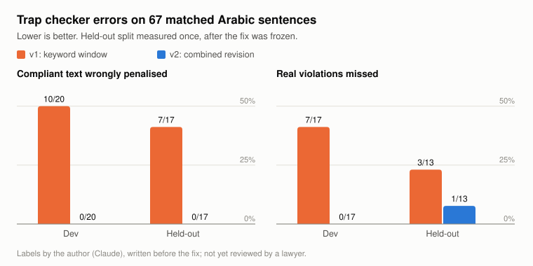

# Arabic Legal Reward Reliability

### Better evidence and better rewards for Arabic legal AI in MENA

**Can an Arabic legal evaluator reliably distinguish a substantive error from a correct variation in wording—and reward what a domain expert considers important?** This project studies both requirements. A combined revision of checker logic and trap definitions reduced errors on a small held-out sentence set. Expert rubric revisions lowered rewards for weak controls, but also amplified detection errors and an unstated jurisdiction requirement. **Expert-informed criteria and reliable automated checks are separate requirements for trustworthy rewards.**

**Mohamed Zaghoo** · Applied physics → AI post-training → Arabic legal evaluation

[Verifier reliability](#experiment-1-verifier-reliability) · [Expert rubric sensitivity](#experiment-2-expert-rubric-sensitivity) · [Why this matters](#why-high-quality-data-matters-in-mena) · [Reproduce](#reproduce-the-public-experiment) · [Limitations and next experiment](#limitations-and-next-experiment)

| Original exploratory study | Public, runnable release | Current research stage |
|---|---|---|
| 6 Arabic legal tasks · 109 weighted criteria | 1 synthetic task · 67 frozen Arabic sentences | Verifier testing and expert rubric review; no expert answer grading or RL training |

## Experiment 1: verifier reliability

**Method.** Trap checks detect prohibited claims or actions and can reduce the whole answer's reward. Earlier checks confused rejecting an action with demanding it, and contractual examples with claims about statutory rules. The experiment compares the original and revised checks on 67 AI-authored Arabic sentences across six traps: 37 development items and 30 held-out items. The reported procedure froze the dataset before changes and evaluated the held-out split once after the revision was frozen.

The revision combines clause-scoped negation handling, contractual-context exceptions, and changes to trap patterns. Its measured effect is the combined revision; an ablation would be needed to isolate each contribution.

**Result.** On the held-out split:

| Error | Original checker | Revised checker |
|---|---:|---:|
| Compliant sentences wrongly penalised | 7/17 | **0/17** |
| Violations missed | 3/13 | **1/13** |



**Limit.** These are small-sample results against AI-authored labels, not independent legal judgments. Zero errors in 17 compliant items still has a one-sided 95% upper bound of about 16%. Clause scoping remains a heuristic.

[Dataset, method and error analysis](experiments/verifier_validation/README.md).

## Experiment 2: expert rubric sensitivity

**Method.** One external expert, described by the author as a licensed lawyer with five years in commercial and corporate practice, reviewed the full NDA and probation rubrics. All **41 criteria** were retained; **seven weights** changed, **eight whole-answer penalties** were added, and the NDA return/deletion scoring method was revised. The same saved answers were rescored using the corrected checker and cached judge scores. No answers were regenerated.

**Result.** Scores below are rewards on a 0–1 scale. “Before” uses the corrected checker with the earlier rubric; “expert” uses the revised rubric.

| Answer | NDA before → expert | Probation before → expert |
|---|---:|---:|
| Reference | 0.87 → 0.87 | 0.91 → 0.92 |
| Claude Opus 5.5 | 0.76 → 0.62 | 0.38 → 0.30 |
| GPT-6 Astra | 0.66 → 0.42 | 1.00 → 1.00 |
| Copy of the prompt | 0.16 → **0.07** | 0.36 → **0.14** |

Prompt-copy controls received lower rewards, reference scores remained similar, and model order was unchanged. This shows sensitivity to rubric design; it does not yet establish better agreement with expert judgments. A score of 1.00 means full credit under the rubric, not complete legal correctness.

**Failure analysis.** The revisions also increased the cost of existing weaknesses:

- **Missed wording:** Astra left NDA durations open as «[مدة الاتفاقية]», but the checker expects a time unit inside the brackets. Partial credit now also triggers a ×0.8 whole-answer penalty.
- **Citation format:** Claude cited Article 88 as «(88)» in a table. The rubric's method allows credit for citing the article alone, but the pattern misses this form. The answer also omits the substantive seven-day deadline, illustrating why matching the rubric and assessing legal completeness are separate questions.
- **Unstated requirement:** the NDA prompt omits Saudi jurisdiction, yet the new forum penalty reduces both models' rewards for missing Saudi forum options.

A new multiplier of ×0.7–0.9 reduces the otherwise calculated reward by 10–30%, in addition to any lost criterion credit. Multiple penalties compound. Making a criterion more consequential therefore increases the importance of detecting it reliably.

**Limit.** The expert reviewed the rubrics, not the candidate answers. These private-corpus rescoring results cannot be independently reproduced from the public release.

[Changes and per-answer analysis](experiments/expert_rubric_review/README.md) · [Machine-readable results](experiments/expert_rubric_review/results.json). The [historical research note](docs/RESEARCH_NOTE.md) preserves the original six-task model scores and corrected-checker reruns.

## Why high-quality data matters in MENA


An Arabic contract, legal memo, or demand letter carries more than language. Its meaning depends on the jurisdiction, relevant date, source documents, parties, and the action being requested. MENA is not a single legal system, and this Saudi-focused study does not establish coverage across the region or its languages.

The research thesis is straightforward: **useful domain data must tell a model what to do, give it the evidence needed to do it, and let an evaluator distinguish success from a plausible mistake.** More examples alone cannot resolve an unstated requirement or an unreliable answer key.

| What quality requires | In legal tasks |
|---|---|
| Explicit context | Jurisdiction, applicable date, contract terms, and the client's instructions |
| Traceable evidence | Source document, relevant provision, and citation verification status |
| Precise success conditions | Preserve rights, identify material issues, and obey drafting constraints |
| Meaning-sensitive grading | Distinguish a prohibition from its negation and contractual terms from statutory rules |
| Independent validation | Qualified review of legal reasoning and criterion-level labels |

The present pilot focuses on Arabic legal drafting and review. Its immediate priority is to validate whether the evaluator distinguishes substantive legal errors from correct variations in wording. A training reward is only as useful as the evidence and verifier behind it; whether better legal task data improves trained-model behavior remains a question for a future controlled experiment.

Arabic evaluation already has substantive foundations: [ArabicMMLU](https://aclanthology.org/2024.findings-acl.334/) draws on regional educational material, while [ArabLegalEval](https://aclanthology.org/2024.arabicnlp-1.20/) evaluates Arabic legal knowledge. This smaller project examines a specific issue within that broader effort: **the reliability of rewards for open-ended professional drafting.**

## Reproduce the public experiment


Python 3.10+; no API key or external dependency needed:

```bash
python3 -m unittest discover tests
python3 -m experiments.verifier_validation.measure
python3 -m legal_rlvr.evaluate
python3 tools/check_release.py
```

The demo deliberately retains a naive trap: a reminder rejecting compensation is penalised for mentioning it. A test demonstrates the revised checker on the same mechanism.

The synthetic example earns **0.375**: a 0.75 base score multiplied by a 0.5 gate. Eight tests cover the demo (including reproduction of the known defect and its fix) and reproduce the verifier-validation numbers. Passing them does not establish semantic correctness. Evaluation writes and replaces `results/report.md` and `results/scores.json`.

```python
from legal_rlvr import LegalDraftingEnv

env = LegalDraftingEnv("synthetic_notice", use_judge=False)
prompt = env.reset()
reward, evidence = env.step("Your candidate answer")
```

The original six task packages, source-derived references, raw model outputs, and session logs are withheld. This checkout reproduces the synthetic failure demonstration, **not the historical six-task scores**. See [release scope](docs/RELEASE_SCOPE.md).

### How the reward is calculated

```text
Task + candidate answer
        ↓
Arabic normalization → deterministic checks
        + optional rubric-based LLM judge
        ↓
Per-criterion scores and evidence
        ↓
Weighted score × failed-gate multipliers
```

`reward = (sum(weight × item_score) / sum(scored_weights)) × product(failed_gate_multipliers)`

A failed gate loses criterion credit and reduces the whole answer's reward. Rules-only mode excludes judge criteria from the denominator. This is a hybrid evaluation prototype: pattern matches and LLM judgments do not establish legal correctness. [Technical methods](docs/METHODS.md).

## Limitations and next experiment

The two experiments support different levels of evidence: the sentence-level verifier experiment is publicly reproducible; the expert-rubric results summarise private reruns. One expert reviewed two rubrics, with qualifications reported by the author rather than independently verified. The original model study has one saved answer per model per task, different generation harnesses, a Claude judge, and rubrics revised after inspecting outputs. It cannot establish a model ranking. No model weights have been trained or updated.

**Next experiment: measure agreement with independent expert judgments.** Have the expert grade saved answers blind to model identity and before seeing automated scores. Compare criterion-level agreement and answer ordering across rubric versions, then add a second expert to estimate inter-expert agreement.

Further work follows from the observed failures:

- Validate the eight newly penalised criteria on frozen examples, including Arabic paraphrases and formatting variations; obtain independent labels and hold out scenario families.
- Separate checker-logic changes from pattern changes in an ablation, and test on a new independently authored set.
- Make NDA jurisdiction explicit in a new prompt version before generating new answers.
- Publish one independently authored Saudi legal case with dated official sources, a reviewable rubric, and positive and negative controls.

[Historical research note](docs/RESEARCH_NOTE.md) · [Release scope](docs/RELEASE_SCOPE.md) · [Technical methods and limitations](docs/METHODS.md)

Development used AI assistance for code, examples, documentation and analysis. No employer or model-provider endorsement is implied.

No open-source license has been selected; public visibility alone does not grant reuse rights.
